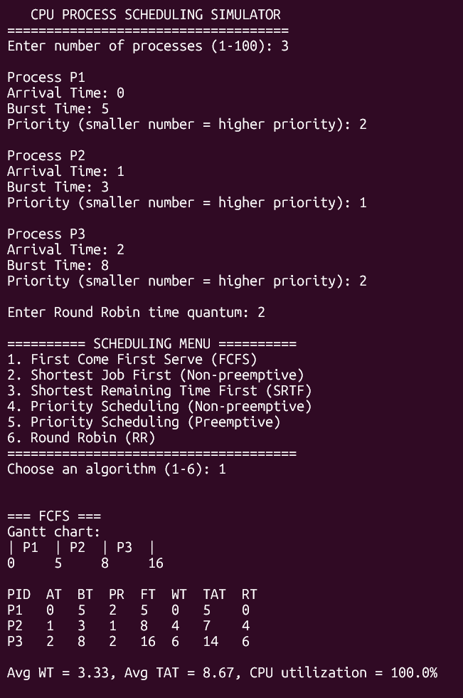
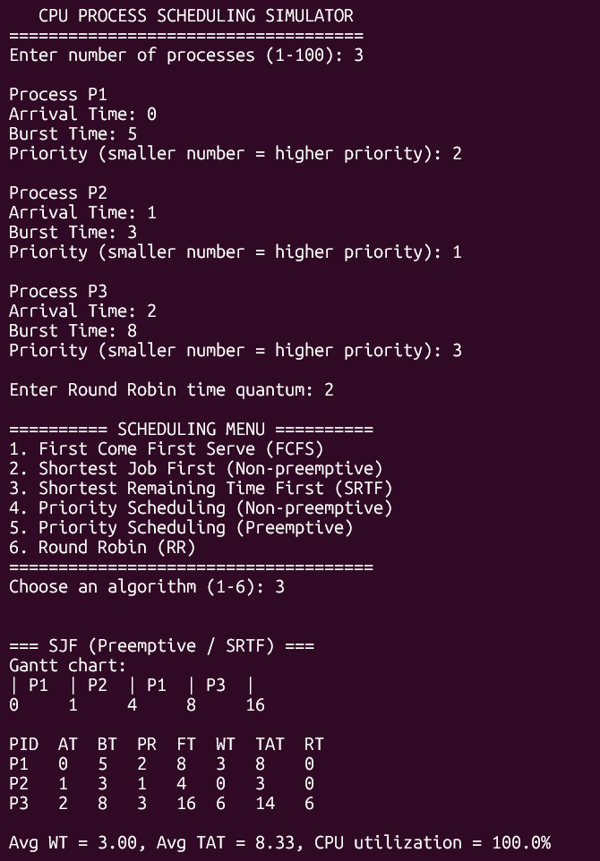
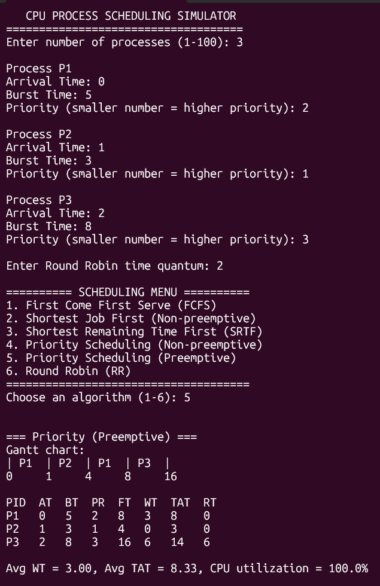
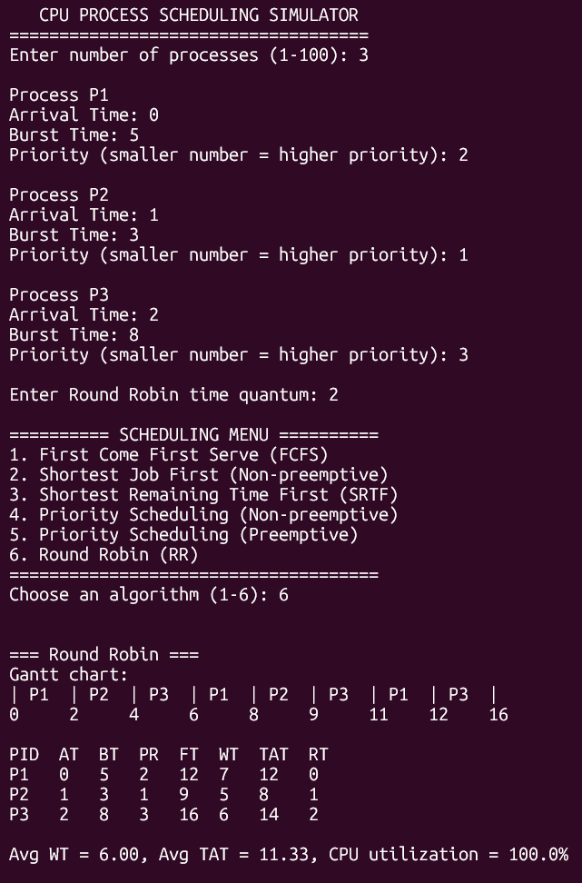
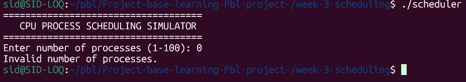

# Week 3 — CPU Process Scheduling Simulator

## Overview

This project implements six CPU scheduling algorithms in C. It simulates how an operating system schedules processes on the CPU and calculates scheduling performance metrics.

## Scheduling Algorithms

1. First Come First Serve (FCFS)
2. Shortest Job First (SJF) — Non-preemptive
3. Shortest Remaining Time First (SRTF) — Preemptive
4. Priority Scheduling — Non-preemptive
5. Priority Scheduling — Preemptive
6. Round Robin (RR)

## Features

- User input for the number of processes.
- Input for process arrival time, burst time, and priority.
- Menu-based algorithm selection.
- Configurable time quantum for Round Robin.
- Gantt chart generation.
- Calculation of finish time, waiting time, turnaround time, and response time.
- Average waiting time and average turnaround time.
- CPU utilization reporting.
- Handling of CPU idle time.

## Requirements

- GCC compiler
- Linux or another environment with a C compiler
- Terminal or command prompt

## Project Structure

```text
week-3-scheduling/
├── main.c
├── scheduler.h
├── utils.c
├── fcfs.c
├── sjf.c
├── priority.c
├── rr.c
├── test.c
└── tests/
    └── test.c
```

## Compilation

Compile the project from the `week-3-scheduling` directory:

```bash
gcc -Wall -Wextra -std=c11 \
    main.c utils.c fcfs.c sjf.c priority.c rr.c \
    -o scheduler
```

## Running the Program

```bash
./scheduler
```

Enter the number of processes, then provide each process's arrival time, burst time, and priority. Enter a positive time quantum for Round Robin and select an algorithm from the menu.

**Priority convention:** A smaller priority number represents a higher priority.

## Performance Metrics

- **Finish Time (FT):** Time at which a process completes.
- **Turnaround Time (TAT):** Finish time minus arrival time.
- **Waiting Time (WT):** Turnaround time minus burst time.
- **Response Time (RT):** First CPU start time minus arrival time.
- **CPU Utilization:** Percentage of elapsed time during which the CPU is busy.

## Sample Test Case

| Process | Arrival Time | Burst Time | Priority |
|---|---:|---:|---:|
| P1 | 0 | 5 | 2 |
| P2 | 1 | 3 | 1 |
| P3 | 2 | 8 | 3 |

Round Robin time quantum: `2`

### FCFS Sample Results

| Process | Finish Time | Waiting Time | Turnaround Time |
|---|---:|---:|---:|
| P1 | 5 | 0 | 5 |
| P2 | 8 | 4 | 7 |
| P3 | 16 | 6 | 14 |

- Average waiting time: 3.33
- Average turnaround time: 8.67
- CPU utilization: 100%

## Team Responsibilities

- **Sid:** Main program, shared header, reporting utilities, integration, and documentation.
- **Suhana:** FCFS and SJF algorithms.
- **Prathyush:** Priority scheduling algorithms.
- **Rishab:** Round Robin algorithm.

## Testing

All six scheduling options compiled and ran successfully with the sample three-process input. Their outputs matched the expected results for that test case.

Further testing with varied arrival times, burst times, priorities, and CPU idle periods is recommended.

## Analysis – Priority Scheduling

Priority Scheduling was tested using three test cases in both non-preemptive and preemptive modes.

### Test Results

| Test Case | Scheduling Mode | Average Waiting Time (WT) | Average Turnaround Time (TAT) | CPU Utilization |
|---|---|---:|---:|---:|
| Test 1 | Non-preemptive | 6.00 | 10.25 | 100% |
| Test 1 | Preemptive | 3.75 | 8.00 | 100% |
| Test 2 | Non-preemptive | 4.00 | 7.50 | 100% |
| Test 2 | Preemptive | 4.00 | 7.50 | 100% |
| Test 3 | Non-preemptive | 0.33 | 3.33 | 64.3% |
| Test 3 | Preemptive | 0.67 | 3.67 | 64.3% |

### Observations

- **Test 1:** Preemptive Priority Scheduling performed better, with lower average waiting time and turnaround time because higher-priority processes could interrupt the running process.
- **Test 2:** Both modes produced identical results because no newly arriving process caused a higher-priority interruption.
- **Test 3:** Non-preemptive scheduling performed slightly better. In preemptive mode, P2 interrupted P1 because P2 had a higher priority, increasing P1's waiting time and turnaround time. CPU utilization was 64.3% in both modes due to CPU idle periods.

### Conclusion

The results show that neither mode performs best in every situation. Preemptive Priority Scheduling can reduce waiting time when higher-priority processes arrive during execution. However, interruptions can increase the waiting time of an already running process. The performance depends on process arrival times, burst times, and priority values.

## Learning Outcomes

- Understanding CPU scheduling strategies.
- Comparing preemptive and non-preemptive scheduling.
- Calculating process scheduling metrics.
- Generating Gantt charts.
- Collaborating on a multi-file C project using Git and GitHub.

## Status

Week 3 implementation and initial algorithm testing completed.
## Screenshots

### FCFS Scheduling


### SJF and SRTF Scheduling


### Priority Preemptive Scheduling


### Round Robin Scheduling


### Invalid Input Handling
