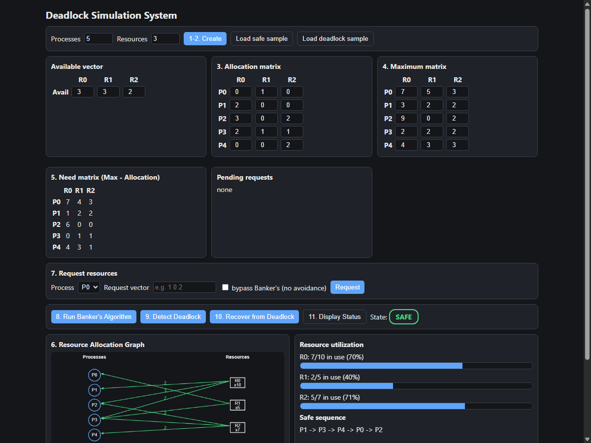
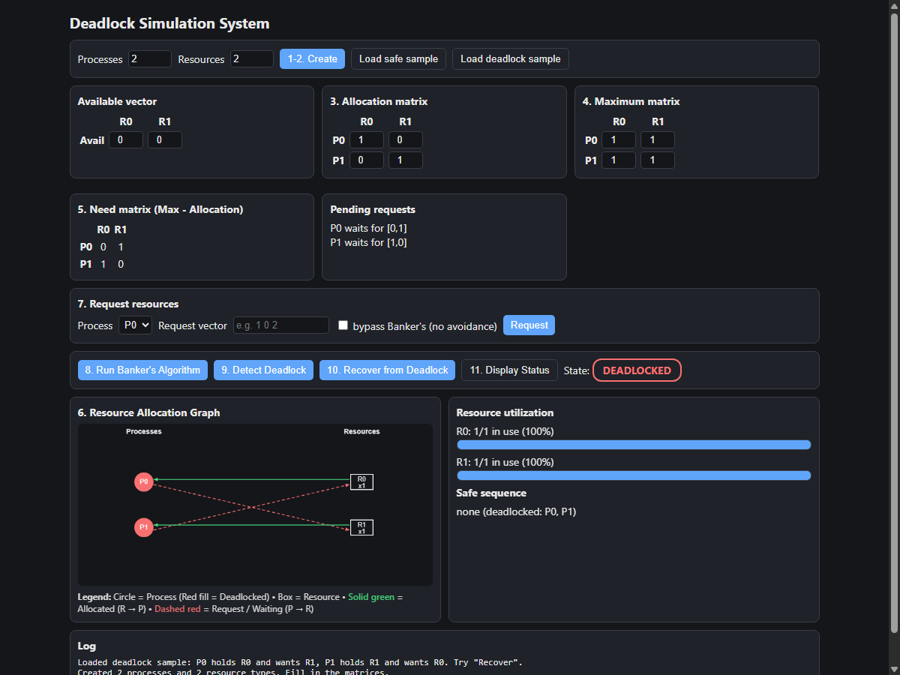

# Week 4 — Interactive Deadlock Simulation System

## 1. Project Overview

In multi-programmed Operating Systems, processes compete for a finite set of resources (such as CPU, memory, files, and I/O devices). When two or more processes permanently block each other because each holds a resource that another needs, a **Deadlock** occurs.

This project implements an interactive **Deadlock Simulation System** in HTML, CSS, and JavaScript. It provides a visual and mathematical model of how an Operating System manages resource allocation, detects deadlocks, avoids unsafe states using **Banker's Algorithm**, visualizes dependencies via a **Resource Allocation Graph (RAG)**, and performs **deadlock recovery**.

---

## 2. Key Objectives & Learning Outcomes

* Understand the concept and four necessary conditions of deadlock.
* Implement and observe **Banker's Algorithm** for deadlock avoidance.
* Differentiate clearly between **Safe**, **Unsafe**, and **Deadlocked** system states.
* Construct and visualize a **Resource Allocation Graph (RAG)** in real time.
* Simulate dynamic resource requests and handle waiting/blocked states.
* Demonstrate **Deadlock Detection** and automated **Deadlock Recovery** (process termination).
* Analyze resource utilization across multiple resource types.

---

## 3. Operating System Concepts & Theory

### A. The 4 Necessary Conditions for Deadlock (Coffman Conditions)
A deadlock can occur if and only if all four of the following conditions hold simultaneously:
1. **Mutual Exclusion:** At least one resource must be held in a non-shareable mode (only one process at a time can use it).
2. **Hold and Wait:** A process is currently holding at least one resource and waiting to acquire additional resources held by other processes.
3. **No Preemption:** Resources cannot be forcibly taken away from a process; they can only be released voluntarily after the process completes its task.
4. **Circular Wait:** A closed chain of processes exists such that $P_0$ waits for a resource held by $P_1$, $P_1$ waits for $P_2$, ..., and $P_n$ waits for $P_0$.

### B. System States
* **Safe State:** A state is safe if the OS can allocate resources to each process (up to its maximum claim) in some order without creating a deadlock. That order is called a **Safe Sequence**.
* **Unsafe State:** A state where no safe sequence exists. An unsafe state is **not** necessarily a deadlock, but it has the potential to lead to one if processes request their maximum claims.
* **Deadlocked State:** A state where two or more processes are permanently blocked and cannot make further progress.

### C. Banker's Algorithm (Deadlock Avoidance)
Named after banking systems that never allocate cash unless they can satisfy all customer demands, Banker's Algorithm maintains four primary data structures:
* **Available Vector $[m]$:** Number of available instances of each resource type.
* **Max Matrix $[n \times m]$:** Maximum demand of each process for each resource type.
* **Allocation Matrix $[n \times m]$:** Number of resource instances currently allocated to each process.
* **Need Matrix $[n \times m]$:** Remaining resource instances each process may still request:
  $$\text{Need}[i][j] = \text{Max}[i][j] - \text{Allocation}[i][j]$$

#### Safety Algorithm Logic:
1. Initialize $Work = Available$ and $Finish[i] = \text{false}$ for all processes.
2. Find an index $i$ such that $Finish[i] == \text{false}$ and $Need[i] \le Work$.
3. If such a process is found:
   $$Work = Work + Allocation[i]$$
   $$Finish[i] = \text{true}$$
   Repeat step 2.
4. If all processes have $Finish[i] == \text{true}$, the system is in a **Safe State**, and the order of finished processes forms the **Safe Sequence**.

### D. Resource Allocation Graph (RAG)
The RAG is a directed graph $(V, E)$ used to track resource claims:
* **Nodes ($V$):**
  * Processes represented as circles ($P_0, P_1, \dots$).
  * Resources represented as rectangles ($R_0, R_1, \dots$).
* **Edges ($E$):**
  * **Assignment Edge ($R_j \to P_i$):** Drawn as a **solid green arrow** indicating that an instance of resource $R_j$ is allocated to process $P_i$.
  * **Request Edge ($P_i \to R_j$):** Drawn as a **dashed red arrow** indicating that process $P_i$ is waiting for resource $R_j$.
* **Deadlock Detection Rule:**
  * If the graph contains **no cycles**, the system is definitely **not** deadlocked.
  * If the graph contains a **cycle** with single-instance resources, a **deadlock exists**.

### E. Deadlock Recovery Strategy
When a deadlock is detected, the simulator recovers the system through **Process Termination**:
1. It inspects all deadlocked processes.
2. It identifies the "cheapest" victim process (the one holding the fewest total resource instances).
3. It terminates the victim process, releases all of its allocated resources back to the `Available` pool, and attempts to fulfill any remaining waiting requests.

---

## 4. How to Run the Simulator

1. Open the file `deadlock_simulator.html` in any modern web browser (Google Chrome, Microsoft Edge, Mozilla Firefox).
2. The page loads with a standard textbook safe sample by default (5 processes, 3 resource types).
3. Use the control buttons:
   * **1-2. Create:** Reconfigures matrices with custom process ($N$) and resource ($M$) counts.
   * **Load safe sample:** Loads the standard safe state scenario.
   * **Load deadlock sample:** Loads a 2-process circular wait scenario.
   * **7. Request:** Tests granting a resource request to a chosen process.
   * **8. Run Banker's Algorithm:** Evaluates system safety and displays the safe sequence in the log.
   * **9. Detect Deadlock:** Checks whether any process is deadlocked and highlights it in red on the RAG canvas.
   * **10. Recover from Deadlock:** Terminates a victim process to resolve the circular wait.
   * **11. Display Status:** Refreshes the system status badge and resource utilization bars.

---

## 5. Project Structure

```text
week-4-deadlock/
├── deadlock_simulator.html       # Single-page interactive simulation system
├── README.md                     # Comprehensive project documentation & viva guide
├── tests/
│   └── test_cases.md             # Documented test scenarios (Safe, Deadlock, Requests)
└── screenshots/                  # Captured simulation output screenshots
```

---

## 6. Viva Preparation Questions & Answers

### Q1: What is the difference between Deadlock Prevention and Deadlock Avoidance?
* **Deadlock Prevention** prevents deadlocks by invalidating at least one of the four Coffman conditions statically at design time (e.g., spooling to prevent mutual exclusion, or ordering resources to eliminate circular wait).
* **Deadlock Avoidance** dynamically decides whether to grant a resource request based on advance information about maximum resource needs (e.g., using Banker's Algorithm to ensure the system always stays in a safe state).

### Q2: Is an unsafe state always a deadlocked state?
No. An unsafe state simply means the operating system can no longer *guarantee* that every process can finish if all processes simultaneously request their maximum declared resources. However, if some processes finish and release resources early without demanding their maximum claims, the system may return to a safe state without ever experiencing a deadlock. Deadlock is a strict subset of unsafe states.

### Q3: How is the Need matrix calculated in Banker's Algorithm?
For every process $i$ and resource type $j$:
$$\text{Need}[i][j] = \text{Maximum}[i][j] - \text{Allocation}[i][j]$$

### Q4: When a resource request is made, what two checks must Banker's algorithm perform before pretending to allocate the resource?
1. $\text{Request} \le \text{Need}[i]$ (The process cannot request more than its declared maximum remaining need).
2. $\text{Request} \le \text{Available}$ (The system cannot allocate more instances than are physically free).

### Q5: What does a cycle in a Resource Allocation Graph signify?
* If each resource type has only a **single instance**, a cycle is both a **necessary and sufficient** condition for deadlock.
* If resource types have **multiple instances**, a cycle is a **necessary condition**, but not always sufficient (other processes holding that resource type may finish and break the cycle).

### Q6: How does the system recover from a deadlock in this simulator?
The simulator uses **Process Termination**: it identifies the victim process holding the lowest total number of resources, terminates it, releases its held resources back to the available pool, and unblocks waiting processes.

---

## 7. Screenshots

### Safe State Simulation & Banker's Algorithm


### Deadlocked State & Resource Allocation Graph

