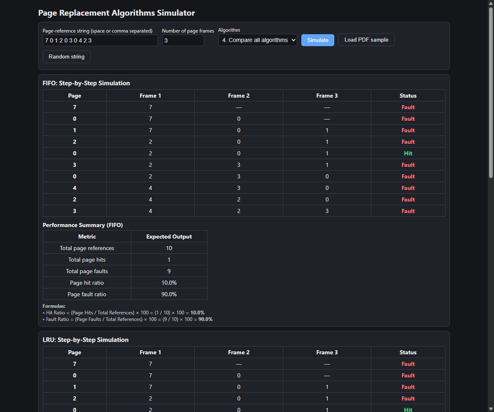

# Week 5 — Simulation and Comparative Analysis of Page Replacement Algorithms

## 1. Project Overview

In a Virtual Memory system utilizing **Demand Paging**, the operating system keeps only a portion of an active program's logical pages in physical memory (RAM). Physical memory is divided into fixed-size blocks called **Frames**, and logical memory is divided into equal-sized blocks called **Pages**.

When a process references a page that is not currently loaded in any physical memory frame, a **Page Fault** occurs. The operating system must trap to the kernel, locate the required page in secondary storage (disk/swap), and load it into a free frame. If all physical memory frames are full, the OS must choose an existing page to evict using a **Page Replacement Algorithm**.

This project provides an interactive simulation tool in HTML, CSS, and JavaScript to analyze, visualize, and compare the three classic page replacement algorithms:
1. **FIFO (First-In, First-Out)**
2. **LRU (Least Recently Used)**
3. **Optimal (OPT / Belady's Min Algorithm)**

---

## 2. Key Objectives & Learning Outcomes

* Understand the mechanism of Virtual Memory and Demand Paging.
* Implement and trace **FIFO**, **LRU**, and **Optimal** page replacement algorithms.
* Observe frame allocation and replacement step by step.
* Distinguish page hits from page faults.
* Compute quantitative performance metrics (**Hit Ratio** and **Fault Ratio**).
* Conduct comparative performance analysis to see which algorithm minimizes page faults for a given reference string.

---

## 3. Algorithm Descriptions

### A. FIFO (First-In, First-Out)
* **Principle:** Replaces the page that has been in memory the longest (oldest arrival time).
* **Implementation:** Maintained conceptually using a simple FIFO queue or circular pointer.
* **Characteristics:** Very simple to implement with minimal hardware overhead.
* **Drawback:** May evict frequently used pages simply because they arrived early. Can suffer from **Belady's Anomaly** (where allocating more frames can result in more page faults for certain reference strings).

### B. LRU (Least Recently Used)
* **Principle:** Replaces the page that has not been referenced for the longest period of time in the past.
* **Implementation:** Tracks the timestamp or logical access time of each page in memory.
* **Characteristics:** Approximates the Optimal algorithm using the principle of **locality of reference** (recent past predicts near future). Does **not** suffer from Belady's Anomaly (it is a stack algorithm).
* **Drawback:** Requires hardware assistance (counters or stack registers) to track page reference times efficiently in a real OS.

### C. Optimal Page Replacement (OPT / MIN)
* **Principle:** Replaces the page that will not be used for the longest period of time in the future.
* **Characteristics:** Guarantees the absolute lowest possible page fault rate for any given reference string and fixed frame allocation.
* **Drawback:** Requires future knowledge of the entire page-reference string, making it impossible to implement in a general-purpose operating system. It is used as an ideal **theoretical benchmark** against which practical algorithms are compared.

---

## 4. Performance Formulas

For any simulation with $N$ total page references:

$$\text{Hit Ratio} = \left(\frac{\text{Page Hits}}{N}\right) \times 100$$

$$\text{Fault Ratio} = \left(\frac{\text{Page Faults}}{N}\right) \times 100$$

$$\text{Total References} = \text{Page Hits} + \text{Page Faults}$$

$$\text{Hit Ratio} + \text{Fault Ratio} = 100\%$$

---

## 5. Official Test Case & Comparative Analysis

Using the standard benchmark from the project specification:
* **Page-Reference String:** `7 0 1 2 0 3 0 4 2 3`
* **Number of Frames:** 3

### Step-by-Step Simulation (FIFO)
| Request | Page | Frame 1 | Frame 2 | Frame 3 | Status |
|:---:|:---:|:---:|:---:|:---:|:---:|
| 1 | 7 | 7 | — | — | **Fault** |
| 2 | 0 | 7 | 0 | — | **Fault** |
| 3 | 1 | 7 | 0 | 1 | **Fault** |
| 4 | 2 | 2 | 0 | 1 | **Fault** |
| 5 | 0 | 2 | 0 | 1 | **Hit** |
| 6 | 3 | 2 | 3 | 1 | **Fault** |
| 7 | 0 | 2 | 3 | 0 | **Fault** |
| 8 | 4 | 4 | 3 | 0 | **Fault** |
| 9 | 2 | 4 | 2 | 0 | **Fault** |
| 10 | 3 | 4 | 2 | 3 | **Fault** |

### Performance Summary
* **Total Page References:** 10
* **Total Page Hits (FIFO):** 1
* **Total Page Faults (FIFO):** 9
* **Page Hit Ratio (FIFO):** 10.0%
* **Page Fault Ratio (FIFO):** 90.0%

### Comparative Summary (All 3 Algorithms)
| Algorithm | Page Hits | Page Faults | Hit Ratio | Fault Ratio | Performance |
|---|:---:|:---:|:---:|:---:|:---|
| **FIFO** | 1 | 9 | 10.0% | 90.0% | Highest faults (9) |
| **LRU** | 2 | 8 | 20.0% | 80.0% | Moderate (8 faults) |
| **Optimal** | 3 | 7 | 30.0% | 70.0% | **Lowest faults (7 faults) — Optimal benchmark** |

---

## 6. How to Run the Simulator

1. Open `page_replacement.html` in any web browser (Google Chrome, Microsoft Edge, Mozilla Firefox).
2. The simulator is pre-loaded with the benchmark string `7 0 1 2 0 3 0 4 2 3` and 3 frames.
3. Click:
   * **Simulate:** Runs the selected algorithm or all algorithms side-by-side.
   * **Load PDF sample:** Instantly resets inputs to the project specification benchmark.
   * **Random string:** Generates a randomized reference string for testing varied sequences.
4. Review the generated step-by-step frame contents, hit/fault indicators, and the comparison summary table.

---

## 7. Project Structure

```text
week-page-replacement/
├── page_replacement.html        # Interactive simulation GUI
├── README.md                    # Detailed documentation & viva guide
├── tests/
│   └── test_cases.md            # Benchmark test cases and expected outputs
└── screenshots/                 # Captured simulation output screenshots
```

---

## 8. Viva Preparation Questions & Answers

### Q1: What is a Page Fault?
A page fault occurs when an executing process attempts to access a logical page that is mapped to virtual address space but is currently not present in physical RAM (its valid-invalid bit in the page table is set to invalid).

### Q2: Why is the Optimal (OPT) algorithm not implemented in real Operating Systems?
The Optimal algorithm requires exact future knowledge of which pages will be referenced and when. In a general-purpose operating system, the future memory access pattern of a running process cannot be known in advance. Hence, OPT serves only as a theoretical benchmark.

### Q3: What is Belady's Anomaly?
Belady's Anomaly is a counter-intuitive phenomenon where increasing the number of physical page frames allocated to a process results in an **increase** (rather than a decrease) in the number of page faults. It can occur in FIFO, but never in stack-based algorithms like LRU or Optimal.

### Q4: Why doesn't LRU suffer from Belady's Anomaly?
LRU is a **stack algorithm**. In a stack algorithm, the set of pages in memory with $n$ frames is always a subset of the pages that would be in memory with $n+1$ frames for the exact same reference string. Therefore, adding more frames can never increase page faults.

### Q5: How is the Hit Ratio related to the Fault Ratio?
The Hit Ratio and Fault Ratio are complementary:
$$\text{Hit Ratio} + \text{Fault Ratio} = 100\%$$
A higher hit ratio indicates better memory management efficiency.

### Q6: What is Thrashing in Virtual Memory?
Thrashing occurs when a computer spends more time swapping pages into and out of memory (paging) than executing actual instructions, typically caused by insufficient physical frames allocated to processes' working sets.

---

## 9. Screenshots

### Simulation and Comparative Analysis (FIFO, LRU, Optimal)

